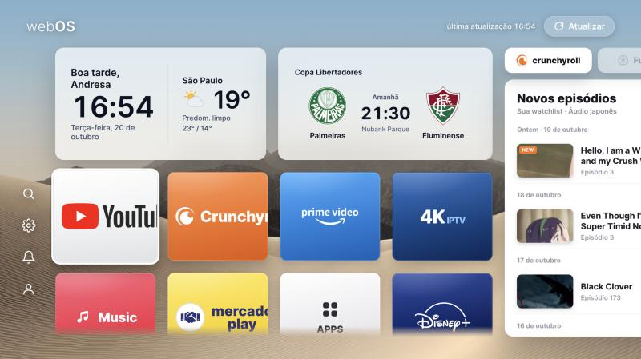

# webOS Home

A custom, Apple-TV-style home screen for a **rooted LG webOS 6.x TV**, built as a
plain static web app and installed as a native `.ipk`. It replaces the busy stock
launcher with a clean grid of apps, live widgets (clock, weather, next match), and
a two-tab side panel showing your real **Crunchyroll** watchlist and **Brazilian
football** fixtures/results — all over a full-screen wallpaper.

> Target device: **LG 75UP8050PSB**, webOS 6.5.3, rooted via the
> [Homebrew Channel](https://github.com/webosbrew/webos-homebrew-channel).
> Personal project, for a TV I own. The old webOS browser engine (Chromium ~79)
> drove most of the technical choices — see [docs/HOW-IT-WORKS.md](docs/HOW-IT-WORKS.md).



---

## Features

- **Live widgets** — greeting + clock + date, local weather (Open-Meteo, no API key),
  and a "next match" card for your club.
- **App grid** — keyboard (D-pad + OK) and pointer (Magic Remote) navigation; launches
  native apps through webOS luna services. Widgets and the grid share one scroll layer.
- **Crunchyroll panel** — your actual watchlist / newest episodes, with thumbnails,
  pulled from your account through a tiny Cloudflare Worker (your cookie never leaves
  your own Worker secret).
- **Football panel** — upcoming games and recent results for a set of clubs
  (Palmeiras, Corinthians, Flamengo, São Paulo, Fluminense by default), aggregated
  from [TheSportsDB](https://www.thesportsdb.com/), with crests, date/time, venue and
  score. Served through the same Worker, which adds caching + CORS.
- **Single refresh button** — one control in the top bar refreshes every on-screen
  API at once, with a timeout-guarded "all updated" toast and a "last updated HH:MM"
  stamp.
- **Boots as the home screen** — optional autostart + Home-button redirect so the TV
  opens straight into this app.

## Repository layout

```
webos-home/
├── index.html            # layout + all CSS (single file, inline styles)
├── app.js                # logic: clock, weather, football, Crunchyroll, navigation, refresh
├── config.js             # ← EDIT THIS: apps, location, teams, Crunchyroll proxy URL
├── logos.js              # inline SVG/HTML logos for the app tiles
├── appinfo.json          # webOS app metadata
├── icon.png              # app icon
├── assets/               # wallpaper, bundled Inter font, logo SVGs
├── crunchyroll-proxy/    # Cloudflare Worker: Crunchyroll watchlist + football aggregation
│   ├── src/index.js
│   ├── wrangler.jsonc
│   └── README.md
├── tools/                # build + deploy scripts (package .ipk, install over the network)
└── docs/                 # documentation (how it works, install, customizing)
```

## Quick start

**Prerequisites:** a rooted webOS TV with the Homebrew Channel, Node.js and Python 3
on your computer, and (for the data panels) a free Cloudflare account.

```bash
# 1. Build the .ipk (manual packaging, no ares-cli needed)
bash tools/build-ipk.sh

# 2. Install it on the TV (over the network). See docs/INSTALL.md for the
#    Homebrew-Channel and Telnet methods and how to make it the home screen.
```

Then deploy the Worker so the Crunchyroll and football panels show live data:

```bash
cd crunchyroll-proxy
npm install
npx wrangler login
npx wrangler secret put CR_ETP_RT   # your Crunchyroll etp_rt cookie
npx wrangler deploy
# put the resulting URL into config.js → crunchyroll.proxyUrl and football.proxyUrl
```

Full walkthroughs:

- **[docs/HOW-IT-WORKS.md](docs/HOW-IT-WORKS.md)** — what was built and how, including the
  old-engine CSS constraints, the data integrations, caching, packaging and autostart.
- **[docs/INSTALL.md](docs/INSTALL.md)** — building the `.ipk`, installing it on the TV,
  and turning it into the actual home screen.
- **[docs/CUSTOMIZING.md](docs/CUSTOMIZING.md)** — changing the apps, location, teams,
  wallpaper, colors and sizes.
- **[crunchyroll-proxy/README.md](crunchyroll-proxy/README.md)** — the Worker: routes,
  the Crunchyroll cookie, the football cache.

## How it works, in one paragraph

The app is pure HTML/CSS/JS (no framework, no build step) packaged into a webOS `.ipk`
by hand (`ar` + `tar`) and installed into `/media/developer/apps`. `config.js` holds
everything you'd want to change; `app.js` renders the widgets and talks to the APIs.
Weather comes straight from Open-Meteo. Crunchyroll and football go through a single
Cloudflare Worker (`crunchyroll-proxy/`) that holds the Crunchyroll cookie as a secret,
aggregates TheSportsDB fixtures per club, caches everything at the edge, and returns it
with permissive CORS so the TV's old browser can read it. See
[docs/HOW-IT-WORKS.md](docs/HOW-IT-WORKS.md) for the details.

## Security notes

- **No secrets in this repo.** The Crunchyroll `etp_rt` cookie lives only in the
  Worker secret `CR_ETP_RT`. The SSAP pairing key (`tools/.lgkey`) is git-ignored and
  generated by pairing with your own TV.
- The `Basic …` token in the Worker is Crunchyroll's **public web client** identifier
  (the same one the website ships), not a personal credential.
- These are **unofficial** integrations of your own accounts; they can break when the
  upstream APIs change.

## License

Currently a private, personal project. If/when it is open-sourced, a license (MIT is a
likely default) will be added here. Until then, all rights reserved.
